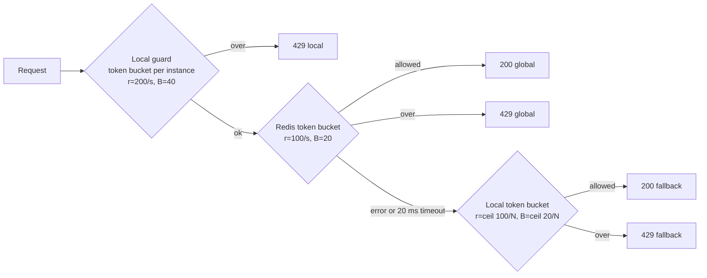

# Rate Limiter PoC

A small TypeScript service that shows three ways to rate limit the same endpoint, and what happens
to each one when it runs as several instances behind a load balancer.

| Endpoint      | Strategy                                                      | Limit per API key           |
| ------------- | ------------------------------------------------------------- | --------------------------- |
| `GET /naive`  | None                                                          | Unlimited                   |
| `GET /basic`  | Fixed window in process memory                                | 100 req/s **per instance**  |
| `GET /robust` | Local guard, then a Redis token bucket, with a local fallback | 100 req/s, burst 20, shared |

Every request needs an `X-API-Key` header (missing or empty returns `401`). Every response carries
`X-Instance` (the IP and port of the instance that answered), so you can see the load balancer at
work. Rejected requests return `429` with `Retry-After` in whole seconds (at least `1`).

## How `/robust` decides



1. **Local guard.** A per instance token bucket per key: 200 req/s with a burst of 40. It rejects
   floods before they reach Redis. Its rate and burst are twice the global ones, so it never
   rejects traffic the global limit would allow. It used to be a fixed window of 200 per second,
   which let a fast client spend all 200 in the first ~150 ms of each window: Redis only saw that
   slice, and a client on one busy connection got 49 req/s instead of 100. A token bucket spreads
   what it lets through evenly across the second.
2. **Global.** One Lua script reads the bucket, refills it using Redis `TIME`, decides, writes it
   back and sets a TTL, all atomically. Every instance shares the same bucket per key.
3. **Fallback.** When Redis errors or takes longer than 20 ms, each instance switches to a strict
   local token bucket sized to its share of the global limit (`N` is `INSTANCES`). The service logs
   once when it enters fallback and once when Redis answers again.

The `X-Limiter-Decision` response header (`local`, `global` or `fallback`) tells you which layer
made the call.

The Redis client is set to fail fast: 20 ms command timeout, no offline queue, no retries per
request, and no resending of in flight commands after a reconnect. When the connection drops, it
reconnects with a backoff that starts at 50 ms and is capped at 1 s, plus up to 100 ms of random
jitter so instances don't reconnect all at once.

When Redis fails or comes back, the switch over-admits for about one second: the layer taking over
starts with a full bucket, so up to one extra burst gets through per switch. Recovery to `global`
takes under a second, thanks to the capped, jittered backoff.

## Project structure

```text
.
├── compose.yaml               # api (N replicas), redis, toxiproxy, haproxy, k6 (on demand)
├── Dockerfile                 # Node 24, runs the TypeScript sources directly
├── haproxy/haproxy.cfg        # http mode on 8080, tcp mode on 8081
├── toxiproxy/toxiproxy.json   # the proxy between the api and Redis
├── load/
│   ├── rate-limit.ts          # the k6 script: scenarios, checks, thresholds
│   ├── run.ts                 # runs k6 once per scenario and endpoint
│   ├── summarize.ts           # per second timeline from a run's samples
│   ├── report.ts              # HTML report with charts per scenario
│   └── runs.ts                # scenario names, endpoints and result paths
├── results/                   # load test output, raw samples not committed
└── src/
    ├── main.ts                # wiring and server start
    ├── config.ts              # typed environment and limits
    ├── redis.ts               # fail fast Redis client
    ├── routes.ts              # API key check, X-Instance, the three endpoints
    └── limiters/
        ├── types.ts
        ├── fixed-window.ts    # /basic and the local guard
        ├── token-bucket.ts    # bucket math and the local fallback limiter
        ├── token-bucket.lua   # the same bucket math, atomically in Redis
        ├── redis-token-bucket.ts
        ├── robust-limiter.ts  # the three layers and fallback logging
        └── *.test.ts          # unit tests for the window and bucket math
```

## Run it

Requirements: Docker with Compose.

```sh
docker compose up --build
```

This starts 3 API instances, Redis, Toxiproxy (between the API and Redis) and HAProxy. Give HAProxy a few seconds to discover the
instances. Two entry points are published:

| Port   | HAProxy mode | Balancing                                                                            |
| ------ | ------------ | ------------------------------------------------------------------------------------ |
| `8080` | `http`       | Per request, even over a kept-alive connection                                       |
| `8081` | `tcp`        | Per connection, like a Kubernetes Service. A kept-alive client stays on one instance |

HAProxy finds the instances through Docker's DNS, so you can change their number without touching
its config (up to 10):

```sh
INSTANCES=5 docker compose up -d
```

Use `INSTANCES` rather than `--scale`, because the same value also sizes the fallback buckets.

### Try it

One request, with all headers:

```sh
curl -i -H 'X-API-Key: demo' localhost:8080/robust
```

300 requests at once for the same key, counted by status code:

```sh
seq 300 | xargs -P 50 -I{} \
  curl -s -o /dev/null -w '%{http_code}\n' -H 'X-API-Key: demo' localhost:8080/basic \
  | sort | uniq -c
```

Swap `/basic` for `/robust` and compare. With 3 instances, `/basic` lets up to 300 requests
through in a second (100 on each instance), while `/robust` holds the shared limit (a burst of 20,
then 100 per second).

Each `curl` opens a new connection, so port `8081` spreads them too. The difference between the
two ports shows up with clients that keep connections open, such as browsers, SDKs and load
testing tools.

### Simulate a Redis outage

```sh
docker compose pause redis     # requests now time out after 20 ms
curl -i -H 'X-API-Key: demo' localhost:8080/robust   # X-Limiter-Decision: fallback
docker compose unpause redis   # back to global
docker compose logs api        # one "entering" and one "leaving" line per instance
```

`docker compose stop redis` also works. After `start`, the client reconnects within about a second.

## Load tests

The load tests use [k6](https://grafana.com/docs/k6/latest/), a load testing tool. A k6 script
says how much traffic to send and for how long. k6 sends it, records every response, and at the end
compares the results with **thresholds**: pass or fail rules such as "at most 30 requests of the
burst were allowed". k6 exits with code `0` when every threshold passes and `99` when one fails.

### The rules

- **The thresholds are the contract a correct limiter must meet:** 100 req/s per API key, with a
  burst of 20. `/robust` must pass them. `/naive` and `/basic` are expected to fail the limiting
  ones, and that is the point of the comparison.
- **One scenario and one endpoint per k6 run**, so every chart shows one thing.
- **A fresh API key per run**, so no run starts with a bucket or window used by an earlier one.
- **Toxiproxy is reset after every run** (and before it), so an injected fault never leaks into
  the next run.
- **`window_boundary` needs one API instance** (`INSTANCES=1`). With `INSTANCES=1` the runner runs
  only `window_boundary`, so a one instance stack can't overwrite the other scenarios' results.
- **A run with `dropped_iterations` above 0 is invalid.** k6 couldn't send the load it was asked
  to send, so the numbers say nothing about the limiter.

### Scenarios

Every scenario runs against HAProxy's port `8080` (balanced per request), except `connections`,
which uses port `8081` (balanced per connection). The stack runs 3 API instances unless noted.

| Scenario           | Load                                                                                                                                   | What it shows                                             |
| ------------------ | -------------------------------------------------------------------------------------------------------------------------------------- | --------------------------------------------------------- |
| `normal_load`      | 100 req/s for 30 s                                                                                                                     | Under normal load all three endpoints look fine           |
| `burst_then_load`  | 100 requests fired together at about 2 s, then 100 req/s from 3 s for 30 s, on the same key                                            | Burst control                                             |
| `window_boundary`  | One instance. 100 requests fired 100 ms before a second boundary, 100 more 50 ms after it                                              | The fixed window boundary problem                         |
| `over_limit`       | 500 req/s for 30 s                                                                                                                     | The "limit times instances" problem                       |
| `connections`      | Port `8081`, 30 s, two clients with their own keys: one connection sending as fast as it can, and 500 req/s spread over 50 connections | The same limiter gives different results per client       |
| `ramp`             | From 0 to 400 req/s over 60 s                                                                                                          | Where each endpoint stops admitting more                  |
| `redis_slow_below` | `/robust` only. 300 req/s for 30 s, Redis replies delayed by 5 ms                                                                      | Below the 20 ms timeout, Redis still decides              |
| `redis_slow_above` | `/robust` only. Same, delayed by 50 ms                                                                                                 | Above the timeout, the fallback decides and nothing hangs |
| `redis_down`       | `/robust` only. 300 req/s for 60 s, Redis cut off from 20 s to 40 s                                                                    | Outage and recovery on one timeline                       |

Fired requests (`burst_then_load`, `window_boundary`) come from one virtual user each. Every
virtual user first opens its connection with a request to `/naive` on a separate key, then waits
for its fire time, so the whole burst lands within a few milliseconds.

Expected results per endpoint:

| Scenario           | `/naive`                 | `/basic`                                       | `/robust`                                                                   |
| ------------------ | ------------------------ | ---------------------------------------------- | --------------------------------------------------------------------------- |
| `normal_load`      | All allowed              | All allowed                                    | All allowed                                                                 |
| `burst_then_load`  | All 100 of the burst     | All 100 of the burst                           | About 20 of the burst, then 100 req/s                                       |
| `window_boundary`  | All 200                  | All 200 within 150 ms                          | At most 40 (the burst of 20 plus 150 ms of refill)                          |
| `over_limit`       | 500 req/s                | About 300 req/s (100 on each instance)         | About 100 req/s                                                             |
| `connections`      | Everything, both clients | About 100 req/s for one connection, 300 for 50 | About 100 req/s for each client                                             |
| `ramp`             | Never flattens           | Flattens at about 300 req/s                    | Flattens at about 100 req/s                                                 |
| `redis_slow_below` |                          |                                                | About 100 req/s, almost all `global`                                        |
| `redis_slow_above` |                          |                                                | About 102 req/s (3 x 34), all `fallback`, fast                              |
| `redis_down`       |                          |                                                | `global`, then `fallback` from 20 s, then `global` again shortly after 40 s |

### Thresholds

Every run checks:

| Threshold                      | Rule                    | Meaning                                                    |
| ------------------------------ | ----------------------- | ---------------------------------------------------------- |
| `dropped_iterations`           | `count==0`              | k6 delivered the load it was asked for                     |
| `http_req_failed{role:load}`   | `rate<0.01`             | Fewer than 1% failed requests (a `429` is not a failure)   |
| `unexpected_status{role:load}` | `count==0`              | Every response is a `200` or a `429`                       |
| `missing_retry_after`          | `count==0`              | Every `429` has a whole number `Retry-After` of at least 1 |
| `checks{role:load}`            | `rate>0.99`             | Response checks pass (status, headers)                     |
| `http_req_duration{role:load}` | `p(95)<50`, `p(99)<100` | Responses stay fast, so a hanging Redis would show up      |

And per scenario:

| Scenario           | Thresholds                                                                                |
| ------------------ | ----------------------------------------------------------------------------------------- |
| `normal_load`      | `limited_rate` below 2%                                                                   |
| `burst_then_load`  | At most 30 of the burst allowed; 2,700 to 3,100 of the load allowed                       |
| `window_boundary`  | At most 40 allowed; every request fired less than 15 ms late                              |
| `over_limit`       | 2,700 to 3,300 allowed                                                                    |
| `connections`      | 2,700 to 3,300 allowed per client; the one connection client sent at least 3,000 requests |
| `ramp`             | 4,700 to 5,800 allowed                                                                    |
| `redis_slow_below` | At most 30 `fallback` decisions (1% of allowed); 2,700 to 3,300 allowed                   |
| `redis_slow_above` | Some `fallback` decisions; at most 3,300 allowed                                          |
| `redis_down`       | Some `fallback` decisions; 5,400 to 6,600 allowed                                         |

The `window_boundary` threshold went from 30 to 40 because the first version of the test was
wrong, not the limiter. One instance needs about 40 ms to process 100 requests, so a burst fired
20 ms before the boundary spilled past it and spent the next window's quota. The bursts now fire
100 ms before and 50 ms after the boundary, and 150 ms of refill at 100 req/s adds 15 to the burst
of 20.

The `redis_slow_below` threshold went from no `fallback` decisions at all to at most 30 (1% of the
~3,000 allowed), for the same reason: the test demanded more than the scenario claims. The claim is
that Redis keeps deciding while it is slower but still under the 20 ms timeout, and over 99.5% of
allowed requests coming from `global` proves that. Demanding zero failed on a healthy limiter: a
few Redis replies take 45-70 ms (likely Docker Desktop VM stalls), and those requests correctly
fall back. Of four runs in Docker, one had 0 fallback decisions and three had 3, 8 and
14, so only one passed the old threshold. All four pass the new one.

Only load requests are tagged `role:load`. Warm up requests and Toxiproxy calls are tagged
`role:control`, so they don't count.

### Run them

Start the stack first, and give HAProxy a few seconds to find the instances:

```sh
docker compose up -d --build
```

You can run k6 in two ways. The commands, filters and results are the same.

**With k6 installed locally** (`brew install k6`):

```sh
npm run load                                        # every scenario, about 15 minutes
SCENARIO=over_limit npm run load                    # one scenario, every endpoint
ENDPOINT=/robust npm run load                       # every scenario, one endpoint
SCENARIO=over_limit ENDPOINT=/basic npm run load    # a single run
```

**With k6 in Docker** (nothing to install). This mode sends the load from inside the Compose
network, so Docker Desktop's port forwarding isn't in the path, and k6 shares the clock of the API
containers, which makes `window_boundary` more precise.

```sh
K6=docker npm run load
K6=docker SCENARIO=over_limit ENDPOINT=/basic npm run load
```

**`window_boundary`** needs one API instance. Restart the stack with one, run it, then go back to
three:

```sh
INSTANCES=1 docker compose up -d
INSTANCES=1 npm run load          # runs window_boundary only
docker compose up -d
```

When a single run is selected, the live dashboard is on at <http://localhost:5665>. k6 waits until
you close the tab before it exits. With several runs the live dashboard is off, so the loop never
waits, and every run still saves its report.

The script loads its end of test summary from `jslib.k6.io`, so k6 needs internet access.

**Without the runner**, call k6 directly. Create the results folder first, because k6 doesn't
create folders:

```sh
mkdir -p results/over_limit-basic

# Local k6
K6_WEB_DASHBOARD=true K6_WEB_DASHBOARD_EXPORT=results/over_limit-basic/report.html \
K6_CSV_TIME_FORMAT=unix_milli \
  k6 run --out csv=results/over_limit-basic/samples.csv.gz \
  -e SCENARIO=over_limit -e ENDPOINT=/basic load/rate-limit.ts

# k6 in Docker
docker compose run --rm --service-ports \
  -e K6_WEB_DASHBOARD=true -e K6_WEB_DASHBOARD_EXPORT=results/over_limit-basic/report.html \
  -e K6_CSV_TIME_FORMAT=unix_milli \
  k6 run --out csv=results/over_limit-basic/samples.csv.gz \
  -e SCENARIO=over_limit -e ENDPOINT=/basic /load/rate-limit.ts

# Then build the timeline and the report
npm run load:summarize -- results/over_limit-basic
npm run load:report
```

### Read the results

Every run writes to `results/<scenario>-<endpoint>/`:

| File              | What it is                                                                                                                                                                                                                                                                                                                                                                                                  |
| ----------------- | ----------------------------------------------------------------------------------------------------------------------------------------------------------------------------------------------------------------------------------------------------------------------------------------------------------------------------------------------------------------------------------------------------------- |
| `report.html`     | The k6 dashboard as a single page with charts. Open it in a browser                                                                                                                                                                                                                                                                                                                                         |
| `samples.csv.gz`  | Every measurement with its timestamp in milliseconds. Peek with `gunzip -c samples.csv.gz \| head`                                                                                                                                                                                                                                                                                                          |
| `thresholds.json` | Every threshold with its expression, whether it passed and the observed value                                                                                                                                                                                                                                                                                                                               |
| `summary.txt`     | k6's end of test summary. `✓` and `✗` mark passed and failed thresholds                                                                                                                                                                                                                                                                                                                                     |
| `timeline.txt`    | One row per second: offered, allowed and limited (rejected with 429) requests, allowed and limited requests by decision (`local`, `global`, `fallback`, or `none` for endpoints without that header), allowed requests per client (`allowed@<scenario>`, only in runs with several clients) and p99 latency. Then the totals, admitted req/s per k6 scenario and the instances that served allowed requests |

At the end, the runner prints one table with every run: scenario, endpoint, admitted req/s and
whether the thresholds passed. A `failed` on `/naive` or `/basic` is the expected result. A
`failed` on `/robust`, or an `error`, needs a look.

The runner then builds an HTML report in `results/report/` (`npm run load:report` rebuilds it from
whatever runs exist). `index.html` holds the same table with links to one page per scenario. Each
page describes the scenario and the expected result, charts allowed req/s per second for every
endpoint against the limit (one chart per client in `connections`; a line far above the others is
labeled with its value instead of drawn, so it doesn't flatten them), charts how `/robust` decided
each second in two charts (allowed by `global` or `fallback`, and rejected (429) by `local`,
`global` or `fallback`), and lists every threshold with its observed value. Pages work offline, in light and dark mode. k6's own `report.html` only charts
its built in metrics, which is why this report exists.

The latest full run is committed under `results/` and its report is published at
<https://zyishai.github.io/rate-limiter/results/report/>. The `samples.csv.gz` files are too large
for the repository, so they are attached to the
[`load-results-2026-11-04` release](https://github.com/zyishai/rate-limiter/releases/tag/load-results-2026-11-04).

## Develop locally

Requirements: Node.js from `.nvmrc` (use `nvm use`) and, for the global layer, Redis on
`localhost:6379`. Without Redis, `/robust` runs in fallback mode.

```sh
npm ci
npm run dev        # restarts on file changes
npm test           # unit tests
npm run typecheck  # tsc, strict
npm run lint       # Biome lint and format check
npm run format     # Biome fixes
```

Node runs the `.ts` files directly (type stripping), so there is no build step.

Environment variables:

| Variable    | Default                  | Meaning                                      |
| ----------- | ------------------------ | -------------------------------------------- |
| `PORT`      | `3001`                   | HTTP port                                    |
| `HOST`      | `0.0.0.0`                | Bind address                                 |
| `REDIS_URL` | `redis://localhost:6379` | Redis connection                             |
| `INSTANCES` | `1`                      | Number of instances sharing the global limit |

In VS Code, install the recommended extensions when prompted. TypeScript 7 needs the
TypeScript Native Preview extension for editor support.

## License

[MIT](LICENSE)
