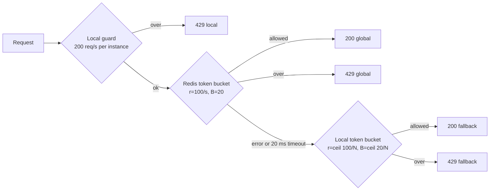

# Rate Limiter PoC

A small TypeScript service that shows three ways to rate limit the same endpoint, and what happens
to each one when it runs as several instances behind a load balancer.

| Endpoint      | Strategy                                                      | Limit per API key           |
| ------------- | ------------------------------------------------------------- | --------------------------- |
| `GET /naive`  | None                                                          | Unlimited                   |
| `GET /basic`  | Fixed window in process memory                                | 100 req/s **per instance**  |
| `GET /robust` | Local guard, then a Redis token bucket, with a local fallback | 100 req/s, burst 20, shared |

Every request needs an `X-API-Key` header (missing or empty returns `401`). Every response carries
`X-Instance` (the IP and port of the instance that answered), so you can see the load balancer at
work. Rejected requests return `429` with `Retry-After` in whole seconds (at least `1`).

## How `/robust` decides



1. **Local guard.** A per instance fixed window of 200 req/s per key. It rejects floods before they
   reach Redis.
2. **Global.** One Lua script reads the bucket, refills it using Redis `TIME`, decides, writes it
   back and sets a TTL, all atomically. Every instance shares the same bucket per key.
3. **Fallback.** When Redis errors or takes longer than 20 ms, each instance switches to a strict
   local token bucket sized to its share of the global limit (`N` is `INSTANCES`). The service logs
   once when it enters fallback and once when Redis answers again.

The `X-Limiter-Decision` response header (`local`, `global` or `fallback`) tells you which layer
made the call.

The Redis client is set to fail fast: 20 ms command timeout, no offline queue, no retries per
request, and no resending of in flight commands after a reconnect. When the connection drops, it
reconnects with a backoff that starts at 50 ms and is capped at 1 s, plus up to 100 ms of random
jitter so instances don't reconnect all at once.

## Project structure

```text
.
├── compose.yaml               # api (N replicas), redis, toxiproxy, haproxy
├── Dockerfile                 # Node 24, runs the TypeScript sources directly
├── haproxy/haproxy.cfg        # http mode on 8080, tcp mode on 8081
├── toxiproxy/toxiproxy.json   # the proxy between the api and Redis
└── src/
    ├── main.ts                # wiring and server start
    ├── config.ts              # typed environment and limits
    ├── redis.ts               # fail fast Redis client
    ├── routes.ts              # API key check, X-Instance, the three endpoints
    └── limiters/
        ├── types.ts
        ├── fixed-window.ts    # /basic and the local guard
        ├── token-bucket.ts    # bucket math and the local fallback limiter
        ├── token-bucket.lua   # the same bucket math, atomically in Redis
        ├── redis-token-bucket.ts
        ├── robust-limiter.ts  # the three layers and fallback logging
        └── *.test.ts          # unit tests for the window and bucket math
```

## Run it

Requirements: Docker with Compose.

```sh
docker compose up --build
```

This starts 3 API instances, Redis, Toxiproxy (between the API and Redis) and HAProxy. Give HAProxy a few seconds to discover the
instances. Two entry points are published:

| Port   | HAProxy mode | Balancing                                                                            |
| ------ | ------------ | ------------------------------------------------------------------------------------ |
| `8080` | `http`       | Per request, even over a kept-alive connection                                       |
| `8081` | `tcp`        | Per connection, like a Kubernetes Service. A kept-alive client stays on one instance |

HAProxy finds the instances through Docker's DNS, so you can change their number without touching
its config (up to 10):

```sh
INSTANCES=5 docker compose up -d
```

Use `INSTANCES` rather than `--scale`, because the same value also sizes the fallback buckets.

### Try it

One request, with all headers:

```sh
curl -i -H 'X-API-Key: demo' localhost:8080/robust
```

300 requests at once for the same key, counted by status code:

```sh
seq 300 | xargs -P 50 -I{} \
  curl -s -o /dev/null -w '%{http_code}\n' -H 'X-API-Key: demo' localhost:8080/basic \
  | sort | uniq -c
```

Swap `/basic` for `/robust` and compare. With 3 instances, `/basic` lets up to 300 requests
through in a second (100 on each instance), while `/robust` holds the shared limit (a burst of 20,
then 100 per second).

Each `curl` opens a new connection, so port `8081` spreads them too. The difference between the
two ports shows up with clients that keep connections open, such as browsers, SDKs and load
testing tools.

### Simulate a Redis outage

```sh
docker compose pause redis     # requests now time out after 20 ms
curl -i -H 'X-API-Key: demo' localhost:8080/robust   # X-Limiter-Decision: fallback
docker compose unpause redis   # back to global
docker compose logs api        # one "entering" and one "leaving" line per instance
```

`docker compose stop redis` also works. After `start`, the client reconnects within about a second.

## Develop locally

Requirements: Node.js from `.nvmrc` (use `nvm use`) and, for the global layer, Redis on
`localhost:6379`. Without Redis, `/robust` runs in fallback mode.

```sh
npm ci
npm run dev        # restarts on file changes
npm test           # unit tests
npm run typecheck  # tsc, strict
npm run lint       # Biome lint and format check
npm run format     # Biome fixes
```

Node runs the `.ts` files directly (type stripping), so there is no build step.

Environment variables:

| Variable    | Default                  | Meaning                                      |
| ----------- | ------------------------ | -------------------------------------------- |
| `PORT`      | `3001`                   | HTTP port                                    |
| `HOST`      | `0.0.0.0`                | Bind address                                 |
| `REDIS_URL` | `redis://localhost:6379` | Redis connection                             |
| `INSTANCES` | `1`                      | Number of instances sharing the global limit |

In VS Code, install the recommended extensions when prompted. TypeScript 7 needs the
TypeScript Native Preview extension for editor support.
